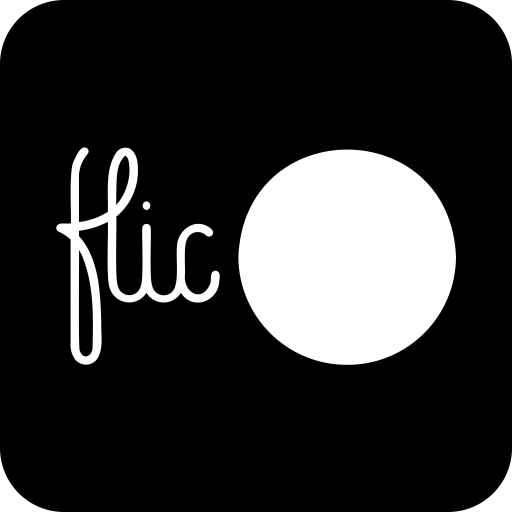

# **Flic Bluetooth for Home Assistant**



Connect supported Flic buttons directly to Home Assistant through its native
Bluetooth integration, including ESPHome Bluetooth proxies. No Flic Hub or
`flicd` daemon is required.

> **Use Home Assistant as your Flic hub.** This integration completely replaces
> the Flic Hub for every button paired with it. It is not a bridge to a Flic Hub,
> and the hub does not participate after migration.

## Home Assistant replaces the Flic Hub

Buttons are paired directly with Home Assistant, which owns their encrypted
Bluetooth connections and turns their presses and gestures into Home Assistant
events. Existing Flic Hub assignments, modules, and automations are not
migrated.

Before moving a button to Home Assistant:

1. Remove it from every Flic Hub or other controller that currently owns it.
2. Put it into public pairing mode.
3. Pair it with **Flic Bluetooth** in Home Assistant.
4. Recreate the button's actions as Home Assistant automations.

A button cannot remain paired with a Flic Hub and Home Assistant at the same
time. Once migrated, the Flic Hub and its modules will no longer receive events
from that button.

## Supported hardware

- Flic v2 round buttons
- Flic Duo
- Flic Twist (untested on hardware; see below)
- Big- and small-button events on Flic Duo
- Single, double, hold, press (`down`) and release (`up`) events
- Four-direction swipes and push-twist rotation on Flic Duo

Legacy Flic v1 buttons are not supported. Flic v1 uses a different,
undocumented protocol and cloud-assisted pairing mechanism. Flic has sold v2
hardware for years, but older round buttons may still be v1.

## Features

- Direct encrypted pairing with Home Assistant
- Local operation without a Flic Hub or cloud service
- ESPHome Bluetooth proxy routing and failover
- Persistent BLE sessions for reliable, low-latency events
- Automatic reconnection: buttons are told to keep advertising for a day
  after a lost link (for example a Bluetooth proxy reboot), are released so
  they keep advertising when Home Assistant restarts or the entry reloads,
  and every advertisement retries the connection, so a press is not lost
  when one connection attempt fails
- Battery voltage reporting
- Swipe recognition without duplicate click events
- Hold recognition without a duplicate click on release

Fall detection, firmware updates, and HID/MIDI configuration are not
currently supported.

## Installation with HACS

This integration is intended to be installed from a tagged GitHub release
through HACS. HACS copies `custom_components/flic_ble/` from the release tag;
the repository does not use `zip_release`, because GitHub's release-asset
redirect sends a header larger than Home Assistant's HTTP client accepts.

Until it is included in the default HACS repository list:

1. In HACS, open **Integrations**.
2. Open the menu and choose **Custom repositories**.
3. Add `https://github.com/jameskorzekwa/ha-flic-ble` as an **Integration**.
4. Install **Flic Bluetooth** and restart Home Assistant.

The Home Assistant integration domain is `flic_ble`.

## Build a strong Bluetooth network first

Reliable Flic operation depends on reliable, continuous Bluetooth coverage at
every button. A single Bluetooth adapter beside the Home Assistant server may
be enough for a small space, but it is usually not enough for a larger,
multi-floor, or RF-challenging home. Set up a distributed Bluetooth network
before pairing buttons that are far from the server.

The recommended approach is to place ESPHome Bluetooth proxies around the home
and let Home Assistant route each Flic connection through the best available
proxy:

- [Set up an ESPHome Bluetooth proxy](https://esphome.io/components/bluetooth_proxy/)
- [Home Assistant Bluetooth proxy documentation](https://www.home-assistant.io/integrations/bluetooth/#remote-adapters-bluetooth-proxies)

Place proxies close enough to the buttons for a strong signal, keep their Wi-Fi
or Ethernet connection reliable, and configure enough active connection slots
for the nearby buttons. Each connected Flic uses one active BLE connection
slot.

The proxy nearest each button must support active BLE connections:

```yaml
bluetooth_proxy:
  active: true
  connection_slots: 3
```

Increase the number of slots or distribute buttons across additional proxies
when supporting more buttons than a nearby proxy can hold.

## Pairing

1. Confirm that the target button has been removed from every Flic Hub or other
   controller. Pairing will fail while another controller still owns it.
2. Hold the button for at least six seconds to enter public pairing mode.
3. In Home Assistant, go to **Settings → Devices & services → Add integration**.
4. Select **Flic Bluetooth** and follow the pairing flow.

## Events

Each button creates a Home Assistant Event entity.

Round Flic buttons and the Flic Duo big button emit:

- `single`, `double`, `hold`
- `down` (pressed) and `up` (released; every release, including the one that
  ends a double click)
- On Flic Duo: `swipe_left`, `swipe_right`, `swipe_up`, `swipe_down`, and
  `rotate_clockwise` / `rotate_counter_clockwise` while the button is held
  (push-twist). Rotation events carry `angle_degrees`, `detent_crossings`,
  `dial_percentage` (a virtual 0-100 % dial per button), `total_turns`, `rpm`
  and `is_first_event`. Rotation in the first 250 ms of a press is held back and
  dropped if the press turns out to be a swipe.

The Flic Duo small button uses the `small_` prefix, such as `small_single`,
`small_hold`, `small_down`, and `small_rotate_clockwise`.

Event data includes the physical button, gesture, event counter, button
timestamp, queue status, and Duo acceleration vector when available.

### Flic Twist

A Flic Twist pairs like any other Flic (hold it for 6 seconds) and emits
`single`, `double`, `hold`, `down` and `up`, plus, depending on its push-twist
mode (Configure on the integration entry):

- **Default**: `twist_increment` / `twist_decrement` and `push_twist_increment`
  / `push_twist_decrement`, with **Twist position** and **Push twist position**
  number entities (0-100 %) that follow the dial and can be set.
- **Continuous**: the same turn events on one endless dial, no position entities.
- **Selector**: `rotate_clockwise`, `rotate_counter_clockwise` and
  `selector_changed`, with one position number entity per slot.

Twist sessions use Shortcut Labs' own pyflic-ble library (vendored, Apache-2.0),
wrapped with this integration's reconnection behaviour: every advertisement
retries the connection, and the Twist is asked to close the link itself when
Home Assistant stops so it keeps advertising. Flic does not publish a Twist
protocol specification, and this support has not been tested on a physical
Twist.

## Protocol and attribution

The integration implements the officially published
[Flic v2 protocol specification](https://github.com/50ButtonsEach/flic2-documentation/wiki/Flic-2-Protocol-Specification)
and
[Flic Duo protocol specification](https://github.com/50ButtonsEach/flic2-documentation/wiki/Flic-Duo-Protocol-Specification).

The Chaskey packet-authentication code was translated from Shortcut Labs AB's
permissively licensed Android reference library. See `NOTICE` and
`FLIC_LICENSE.txt`.

This independent project is not affiliated with or endorsed by Shortcut Labs
AB or Flic.

The Flic wordmark used in the integration icon is reproduced from Flic's
official website solely to identify compatible Flic hardware.
